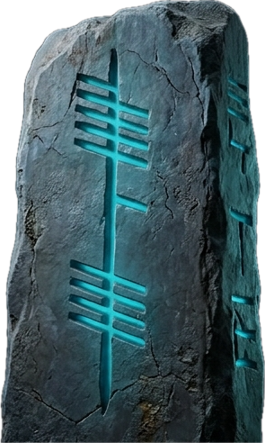

<p align="center">
  
</p>

<h1 align="center">Ogham Note</h1>

<p align="center">
  A native macOS Markdown editor with a real Vim engine. Zero Electron.
</p>

<!-- Screenshot: add docs/media/screenshot.png here once captured. -->

Ogham Note is for people who think in Vim motions but want a quiet,
native Mac app for their notes: modal editing written in pure Swift on top of
`NSTextView`, a folder-based workspace, and a Markdown preview, with nothing
between your keystrokes and the screen but AppKit.

> **Status: early.** Editing, navigation and preview work. Writing changes
> back to disk is not wired up yet (`:w` is a placeholder), so treat it as a
> preview of where this is going rather than your daily notes app.

## Features

- **Modal editing** with Normal, Insert, Visual and Visual Line modes and a
  `:` command bar with history.
- **Vim motions and operators:** `h j k l`, `w b`, `0 $`, `gg G`, `i a A o O`,
  `d y c x p`, undo with `u` and repeat with `.`.
- **Search** in the buffer with `/` and `?`, then `n` / `N`.
- **Workspace sidebar:** open a folder and browse it as a tree; `.gitignore`d
  files stay out of the way.
- **Quick open** (`⌘P`) and search across every file in the workspace.
- **Markdown preview** side by side with the editor, rendered with Apple's
  [swift-markdown](https://github.com/apple/swift-markdown).
- **Themes:** Nord, Dracula, Gruvbox and Monokai.

## Build and run

Requires macOS 14 (Sonoma) or newer and a Swift 6 toolchain (Xcode 16+).

```bash
git clone https://github.com/stephenbreen/ogham-note.git
cd ogham-note
swift run OghamNote
```

`swift build -c release` produces an optimised binary in `.build/release/`,
and `swift test` runs the engine and settings tests.

## How it works

- **`VimEngine`** owns the modal state and the buffer. It is plain Swift with
  no Vim library underneath, which keeps every motion testable on its own
  (see `Tests/OghamNoteTests/VimEngineTests.swift`).
- **`VimKeyMapper`** turns AppKit key events into Vim key notation (`<Esc>`,
  `<CR>`, …) before they reach the engine.
- **`NSTextView`**, wrapped for SwiftUI, does the rendering and the engine
  keeps text and selection in sync with it.
- **`WorkspaceManager`** and **`SearchManager`** handle the folder tree and
  workspace-wide search, with a file cache for repeat searches.

## Roadmap

- [ ] Save buffers to disk (`:w`, `:wq`).
- [ ] `.oghamrc` configuration.
- [ ] More motions and text objects (`e`, `ciw`, counts).
- [ ] Distraction-free mode.

`PRD.md` and `CHECKLIST.md` hold the longer plan.

## License

MIT, see [LICENSE](LICENSE).

---

<sub>Made by [Stephen Breen](https://stephenbreen.github.io).</sub>
